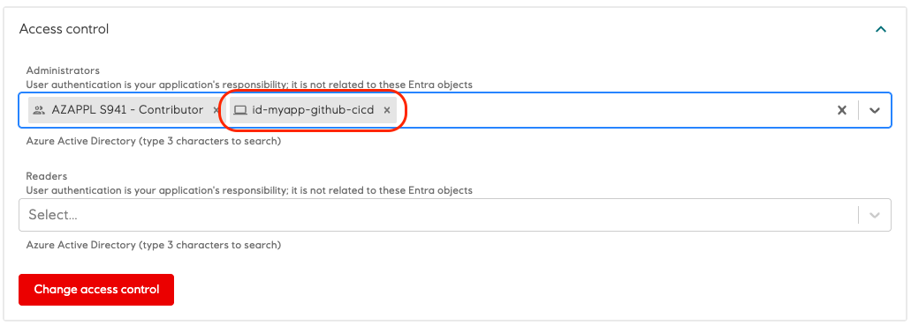
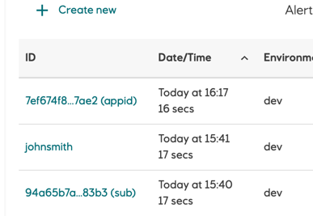
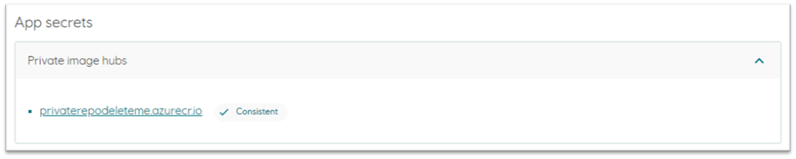
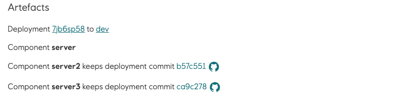
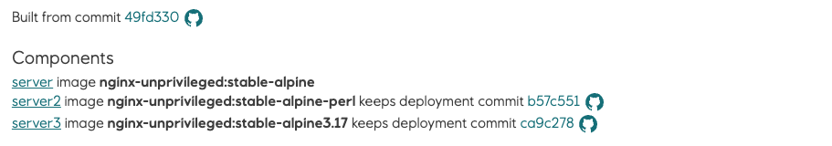
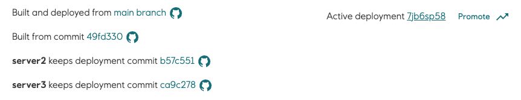

# Deploy Using External CI/CD Tools

Radix can build and deploy your application, but you can also build it with an external CI tool, such as GitHub Actions or Azure DevOps, and let Radix handle only the deployment (CD). An application set up this way is called a deploy-only application.

In a deploy-only application, you build all container images outside of Radix and push them to a container registry. Radix doesn't build anything. It pulls the images you specify in `radixconfig.yaml` and deploys them. Other reasons for choosing this setup include:

- Your application consists of several components (for example microservices) with source code in separate repositories.
- Your application depends on other resources, and the deployment to Radix must be orchestrated with them.
- You need CI features that Radix doesn't provide, such as test reports.

## Configuring the app

Like any other Radix application, a deploy-only application needs:

- A GitHub repository (GitHub is the only supported provider at the moment).
- A `radixconfig.yaml` file that defines the environments. By default, Radix looks for it in the root of the repository.
- A [deploy key](../../start/registering-app/index.md#deploy-key) for the Radix application.

## The repository

A deploy-only application gives you two options for structuring your repositories:

- A pure configuration repository that holds `radixconfig.yaml`, while the source code for each component lives in other repositories.
- A source code repository that also holds `radixconfig.yaml`.

This guide uses the second option.

## The `radixconfig.yaml` file

:::tip
Radix reads `radixconfig.yaml` only from the branch set as the `Config Branch` in the application configuration form. Radix ignores changes to the file in other branches.
:::

A deploy-only application differs from a regular Radix application in three ways:

- The [`image`](../../radix-config/index.md#image) property is set for all components and jobs in `radixconfig.yaml`. [Deploying to Radix](#deploying-to-radix) describes how to specify the image tag.
- The [`privateImageHubs`](../../radix-config/index.md#privateimagehubs) property lets Radix pull images from a private container registry. It's not needed if the images are public.
- Environments have no `build.from` branch mapping. Radix doesn't build a deploy-only application, so a mapping would do nothing. Your CI workflow decides which environment to deploy to.

```yaml
apiVersion: radix.equinor.com/v1
kind: RadixApplication
metadata:
  name: my-app
spec:
  environments:
    - name: qa
    - name: prod
  components:
    - name: api
      image: ghcr.io/my-repo/my-app/api:{imageTagName}
      ports:
        - name: http
          port: 3000
      publicPort: http
      environmentConfig:
        - environment: qa
          imageTagName: master-latest
    - name: frontend
      image: ghcr.io/my-repo/my-app/frontend:latest
      ports:
        - name: http
          port: 8080
      publicPort: http
  privateImageHubs:
    ghcr.io:
      username: <some GitHub user name>
      email: <some email>
```

See the [Radix Config reference](../../radix-config/index.md) for the full `radixconfig.yaml` syntax.

## Registering the application

Register the application as you would a regular Radix application, but don't add the webhook to GitHub. With a webhook, every push to the repository would start a build-deploy pipeline job that does nothing, which only adds noise to the job list. You trigger deployments from your own CI tool instead, as described in the next sections.

## Entra ID service principal

To run a deploy-only pipeline job from an external tool, you must authenticate with an Azure service principal. A [managed identity](https://learn.microsoft.com/en-us/entra/identity/managed-identities-azure-resources/overview) is the preferred option, but an [Entra ID app registration](https://learn.microsoft.com/en-us/entra/identity-platform/quickstart-register-app) also works:

1. Create a managed identity, or use an existing one. Alternatively, use an Entra ID app registration.
2. Add the service principal as an administrator of the application.

   

3. Use the service principal to sign in from your external pipeline job, as described in [Making calls to Radix](#making-calls-to-radix).

Pipeline jobs created by a service principal show up in the pipeline job list in the Radix web console. The job is labeled with the application ID of the service principal followed by `(appid)`, or with its object ID followed by `(sub)`.



See [Connect GitHub and Azure](https://learn.microsoft.com/en-us/azure/developer/github/connect-from-azure) for how to set up federation between GitHub and Azure.

## Making calls to Radix

Your pipeline job can call Radix in one of these ways:

- **Radix GitHub Actions**<br/>The preferred option if you use GitHub Actions for CI. [Radix GitHub Actions](https://github.com/equinor/radix-github-actions) signs in as the service principal and makes it easy to call Radix from your workflow. See the [migration guide from v1 to v2](./migrating-radix-github-action-v1-to-v2.md).
- **Radix CLI**<br/>Sign in as the service principal with one of the supported `rx login` options, then use the [Radix CLI](https://github.com/equinor/radix-cli) to call Radix. This works with any CI tool.
- **Radix API**<br/>Request an access token for the service principal and call the API directly, passing the token as a bearer token, for example `curl -X GET --header "Authorization: Bearer $token" <url>`.

:::warning
An access token is valid for one hour and grants every operation an application administrator can perform, including deleting the application and setting secrets. Keep it secret.
:::

## Deploying to Radix

Every deployment needs a full image reference for each component and job. You specify the image tag in the `image` property in one of two ways:

- **Directly in `image`**<br/>Write the tag as part of the image reference, for example `ghcr.io/my-repo/my-app/frontend:latest`. The component uses the same tag in every environment and every deployment.
- **With `{imageTagName}`**<br/>Put the [`{imageTagName}`](../../radix-config/index.md#imagetagname) placeholder where the tag goes, for example `ghcr.io/my-repo/my-app/api:{imageTagName}`. The `deploy` pipeline replaces the placeholder with the tag you configure, as described below.

With `{imageTagName}`, you can set the tag per environment with the `imageTagName` property under `environmentConfig`, or override it when you start the deploy pipeline job with the `--image-tag-name` flag in the [Radix CLI](../../docs/topic-radix-cli/index.md#commands). The flag takes precedence over `radixconfig.yaml`. If an environment has no `imageTagName`, you must set the tag with `--image-tag-name`.

In the [example `radixconfig.yaml`](#the-radixconfigyaml-file), `frontend` uses `latest` in every environment. The `api` component uses `master-latest` in `qa`, as set by `imageTagName`. It has no `imageTagName` in `prod`, so the deploy pipeline job must set it:

```bash
rx create pipeline-job deploy --application my-app --environment prod --image-tag-name api=release-39f1a082
```

A tag that changes with every build, for example a branch name combined with the commit SHA, gives you better control over what runs in an environment. It also lets you promote an older deployment if you need to roll back.

### Updating a component when the image tag doesn't change

Radix doesn't pull a new image when the tag is the same as in the previous deployment, even if you've pushed a new image to that tag. On each deployment, Radix creates or updates Kubernetes resources from `radixconfig.yaml`. If those resources are unchanged, Kubernetes leaves the running containers alone. A tag written in `image` or set with `imageTagName` in `radixconfig.yaml` leads to unchanged resources, since the file is identical between deployments.

To run the latest image, restart the component. You can do this from the component page in the web console, or with the restart endpoint in the [Radix API](https://api.radix.equinor.com/swaggerui/#/component/restartComponent) or the [Radix CLI](https://github.com/equinor/radix-cli). Which [Radix cluster](../../start/radix-clusters/index.md) hosts the application determines the URL of the Radix API.

To avoid the manual restart, set `alwaysPullImageOnDeploy` to `true` on the component. Every deployment then changes the underlying Kubernetes resource, which makes Kubernetes pull the latest image from the container registry.

```yaml
spec:
  environments: 
  components:
    - name: api
      image: ghcr.io/my-repo/my-app/api:latest
      alwaysPullImageOnDeploy: true
```

:::tip
You can also put the full image reference in the `imageTagName` property:

```yaml
  components:
    - name: app
      image: {imageTagName}
      environmentConfig:
        - environment: qa
          imageTagName: ghcr.io/equinor/myapp/backend:qa
        - environment: dev
          imageTagName: ghcr.io/equinor/myapp/backend:dev
```
:::

## Configure Radix to use an external container registry

On the application `Configuration` page, set the secret for the private image hub to the [personal access token](./example-github-action-to-create-radix-deploy-pipeline-job.md#configuring-a-personal-access-token) you created, which needs permission to read packages. This gives Radix access to pull the packages that `radixconfig.yaml` refers to. You only need this if the images in the registry are private.



## Deploy only specific components

If a Radix application has several components and you only need to deploy some of them, use the `--component` flag in Radix CLI to specify which components to deploy. You can specify the option multiple times, for example `--component api --component frontend`. Radix doesn't redeploy the other components in the environment. They keep their `commitID`, `gitTags`, environment variables, and secrets, and their replicas aren't restarted.

See the [Radix CLI deploy command](../../docs/topic-radix-cli/index.md#deploy-pipeline-job) for examples. You can also use the `component` option with the [Radix GitHub action](https://github.com/equinor/radix-github-actions) and the Radix API.

When a deploy pipeline job runs with the `--component` flag, the Radix Web Console shows which components weren't deployed on the pipeline job, deployment, and environment pages:

_Component **component1** keeps deployment commit @b57c551_

The commit (`@b57c551`) is shown only if the previous deployment of the component has a `CommitID`.

**Pipeline job**



**Deployment**



**Environment**



## Example

The [example workflow](./example-github-action-to-create-radix-deploy-pipeline-job.md) deploys `master` to `qa` with the tag set by `imageTagName` in `radixconfig.yaml`, and `release` to `prod` with a tag set by `--image-tag-name`. The example page describes each step in the workflow.